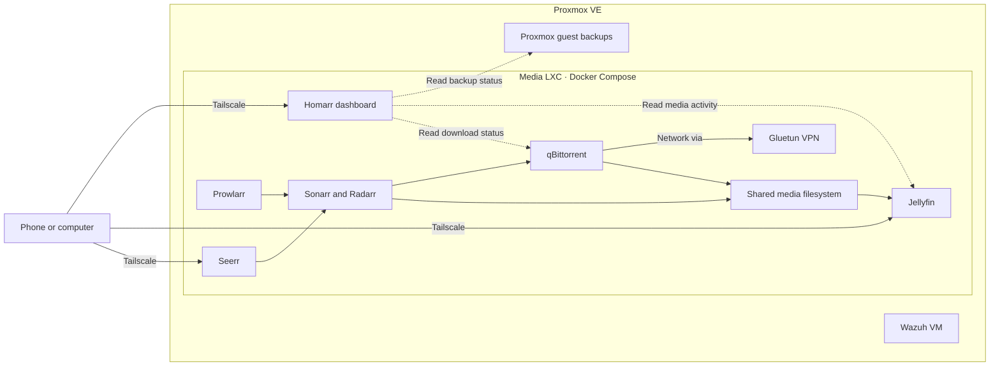

# Proxmox Homelab

A self-hosted media and monitoring lab built on Proxmox VE. Jellyfin serves the media library, Seerr handles requests, and Homarr brings playback, downloads, storage, and backup status into one dashboard. Tailscale provides private access from phones and computers.

## Architecture

| Component | Role |
| --- | --- |
| Proxmox VE | Runs the media container and Wazuh virtual machine |
| Docker Compose | Runs the media and dashboard services inside the container |
| Jellyfin and Seerr | Playback and media requests |
| Sonarr, Radarr, Prowlarr, and Bazarr | Library management, indexer configuration, and subtitles |
| qBittorrent and Gluetun | Download client with VPN networking |
| Homarr | Service shortcuts, activity, storage, and backup status |
| Tailscale | Private access to the dashboard and services |
| Wazuh | Security monitoring |

## Dashboard

The mobile layout puts Jellyfin, Seerr, and qBittorrent in one row, with download progress directly below. The dashboard also shows active playback, the release calendar, requests, Proxmox and Docker status, and free space on the media filesystem.

The backup card shows recent Proxmox job results and the newest saved guest archives. It surfaced a failed backup when the destination fell below the capacity guard's estimate.

## Design decisions

- **Shared media filesystem.** Downloads and the library use a common filesystem so supported imports can use hardlinks.
- **Private service access.** Administration interfaces are reached over Tailscale. Jellyfin also supports playback on the home LAN.
- **VPN isolation.** qBittorrent shares Gluetun's network namespace.
- **Backup capacity check.** Proxmox checks available space before starting a local guest backup, with headroom for the estimate and a reserve for the host.

## Migration and cleanup

The media stack moved from native Linux services to Docker Compose inside the existing Proxmox LXC. Once the Docker bind mounts and service health were verified, the retired installations were removed. The cleanup recovered **1.22 GiB** on the container system disk while all 13 Docker containers stayed running. The pre-migration snapshot was kept for recovery.

## Repository contents

This repository documents a running homelab. Service names and example URLs are provided for reference. Installation requires your own storage paths, credentials, and network configuration.

- [Migration and legacy cleanup](docs/migration.md)
- [Operations guide and backup case study](docs/operations.md)
