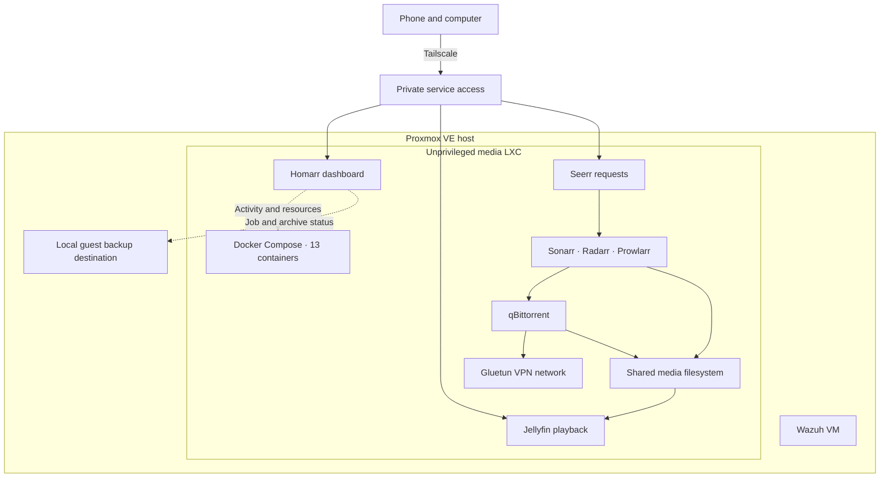

# Homelab Infrastructure & Operations

## Executive overview

The homelab consolidates media playback, requests, library management, monitoring, and private access on a Proxmox VE host. The media applications run in Docker Compose inside an unprivileged Linux container. A separate virtual machine provides Wazuh security monitoring.

The work moved the original media applications into Docker, repaired Tailscale access, expanded the Homarr dashboard, and removed retired application files after checking the active containers' dependencies. Two later user-requested media cleanup batches removed three selected movies and reconciled the library catalog.

The legacy cleanup recovered **1.22 GiB** on the container system filesystem. The initial media cleanup recovered **15.16 GiB**. A follow-up removal recovered **4.17 GiB**, bringing measured media recovery across both batches to approximately **19.32 GiB** and leaving **132.18 GiB available** after the latest operation. These measurements refer to separate filesystems and separate maintenance operations.

Fresh checks on November 11 at 11:15 p.m. Eastern time found **13 Docker containers running** and **all nine tested service endpoints responding**. The outstanding operational issue is local guest backup capacity. Scheduled jobs on November 10 and 11 were refused by the preflight guard. The most recent successful job in the inspected history ran on November 9.

## Architecture

### Resource allocation at inspection

| Guest | vCPU cores | Memory | Storage allocation |
| --- | --- | --- | --- |
| Media LXC | 4 | 8 GiB | 32 GiB system volume and 250 GiB media volume |
| Wazuh VM | 4 | 8 GiB | 40 GiB virtual disk |

The media LXC is unprivileged. TUN device passthrough supports Tailscale, and a render device is assigned for the media workload. Device assignment is a configuration observation. Transcoding performance requires a playback test.

### Service inventory

| Layer | Containers | Purpose |
| --- | --- | --- |
| Playback and requests | Jellyfin, Seerr | Library playback and request management |
| Library automation | Sonarr, Radarr, Prowlarr, Bazarr, Recyclarr | TV, movies, indexers, subtitles, and configuration synchronization |
| Downloads and networking | qBittorrent, Gluetun | Download client sharing the VPN container's network |
| Supporting services | Byparr, Cleanuparr | Indexer support and download maintenance |
| Dashboard and container visibility | Homarr, socket-proxy | Unified service access and Docker status |

## Implementation record

### Private remote access

Tailscale initially failed inside the media LXC because the container lacked access to `/dev/net/tun`. Device passthrough was added and the container was shut down and started again. Following account authorization, Tailscale joined the existing network.

The repair was validated through a Tailscale connection from the Proxmox host. Jellyfin returned a healthy response and its web interface returned HTTP 200. The dashboard and service shortcuts subsequently used Tailscale destinations for mobile access.

### Docker migration

The original Jellyfin, Radarr, Sonarr, Prowlarr, and qBittorrent installations ran as native services inside the media LXC. Their replacements were deployed through Docker Compose in that same guest.

The stack uses dedicated application data directories and a shared media filesystem. The shared filesystem supports hardlink imports where configured, allowing an imported library entry and its download entry to reference the same underlying file data. qBittorrent shares Gluetun's network namespace.

A Proxmox snapshot from before the migration was retained for recovery. Migration details are recorded in the linked homelab documentation.

### Homarr dashboard

The dashboard groups Jellyfin, Seerr, and qBittorrent into a compact shortcut row. Download progress appears immediately below. The phone layout places library tools and administration further down the page.

The deployed widgets include current playback, a release calendar, requests, download progress, media filesystem capacity, recent backup jobs, saved guest archive dates, Proxmox resources, Docker container state, a clock, and weather.

Two read-only Custom Widgets use existing integrations. The storage widget obtains filesystem capacity through Radarr. The backup widget obtains job results and local archive metadata through Proxmox. Their refresh intervals are one minute and five minutes respectively.

Desktop and iPhone-sized browser checks verified widget rendering, the Jellyfin destination, and the absence of horizontal page overflow. All eight saved integrations passed their connection checks during the dashboard work.

## Maintenance outcomes

### Legacy application cleanup

The retired native services were already disabled and inactive. Before deletion, the active Docker bind mounts were inspected to confirm that the live containers used their dedicated application data directories and the shared media mount.

Package removal was previewed. The retired Jellyfin and qBittorrent packages were removed, along with the old Radarr, Sonarr, and Prowlarr binaries, service definitions, and unused native data directories.

The cleanup increased free space inside the system filesystem by **1.22 GiB**. All **13 Docker containers stayed running**, and application checks passed afterward. The pre-migration snapshot was retained. Its references can preserve blocks on the underlying storage pool after active filesystem deletion.

### User-requested media cleanup

Two movie entries were positively identified before removal. Their library files had one filesystem link each. Checks found no matching active download entries or residual download copies.

The entries were deleted through Radarr with file deletion and import exclusions enabled. File removal completed asynchronously, so verification waited for both directories to disappear. The other **20 Radarr movie records** were preserved.

A Jellyfin library refresh confirmed that both selected entries were absent from the catalog. Available media filesystem space increased by **15.16 GiB**, reaching **128.22 GiB free** at the post-removal measurement. Import exclusions prevent automatic re-imports through Radarr lists.

A further movie removal required title clarification before deletion. Once the owner confirmed the exact entry, the file and record were removed and Jellyfin was refreshed. This operation recovered another **4.17 GiB**, left **132.18 GiB free**, and preserved the other **19 Radarr movie records**. The import exclusion was verified. All nine service endpoint checks passed afterward.

## Backup operations and incident

The scheduled local guest job targets both the media LXC and Wazuh VM. A preflight script estimates required capacity from allocated blocks across the selected guest volumes. It adds **25% headroom** and a **10 GiB host reserve**. Existing archives consume space on the same destination.

On November 10, the destination had **63.0 GiB available** and the guard estimated **168.5 GiB required**. The job stopped at preflight. The previous successful job had passed with an estimate of **50.2 GiB**. The inspected logs establish the increase in estimated requirements. They do not attribute that increase to individual files.

| Scheduled run, Eastern time | Recorded result |
| --- | --- |
| November 9, 2026, 2:00 a.m. | Successful |
| November 10, 2026, 2:00 a.m. | Refused by capacity guard |
| November 11, 2026, 2:00 a.m. | Refused by capacity guard |

The dashboard now displays these outcomes alongside saved guest archive dates. Media filesystem availability and backup destination availability must be checked independently. Media stack configuration snapshots are another backup artifact and have their own coverage and timestamps.

## Validation and evidence

| Workstream | Verification performed | Recorded outcome |
| --- | --- | --- |
| Remote access | Tailscale connectivity and Jellyfin HTTP response | Connected and responding after repair |
| Dashboard | Eight integration connection tests and desktop/mobile browser checks | Connections and rendering passed |
| Legacy cleanup | Bind-mount review, container continuity, and service responses | 13 containers stayed running and 1.22 GiB recovered |
| Media cleanup | Exact record identification, link counts, filesystem deletion, and catalog refresh | Three entries removed across two batches and approximately 19.32 GiB recovered |
| Current availability | Container inventory and nine API/web requests | 13 containers running and nine HTTP 200 responses |
| Backup status | Proxmox task history and failure logs | Capacity failures remain open |

The nine current endpoint checks cover Homarr, Jellyfin, Seerr, Radarr, Sonarr, Prowlarr, qBittorrent, Bazarr, and Cleanuparr. They establish HTTP response availability. Off-site playback, transcoding performance, and complete backup restoration remain separate validation tasks.

Measurements are point-in-time observations. Container filesystem recovery, thin-pool allocation, snapshot references, and physical disk recovery are distinct accounting layers.

## Follow-up work

1. Resolve the backup destination capacity shortfall and verify a subsequent scheduled guest backup.
2. Perform an isolated restore test against a selected backup and record the result.
3. Review the retained pre-migration snapshot when its recovery value has been assessed.
4. Continue documenting verified changes, incident outcomes, and topology updates in GitHub.

## Evidence basis

This report draws on recorded maintenance results and fresh service, container, filesystem, and Proxmox task-history checks. Publication uses aggregate results and sanitized architecture details.

[Primary homelab documentation](https://github.com/J0N3B0I/Proxmox-homelab) · [Migration record](https://github.com/J0N3B0I/Proxmox-homelab/blob/main/docs/migration.md) · [Maintenance change log](https://github.com/J0N3B0I/Proxmox-homelab/blob/main/CHANGELOG.md)
